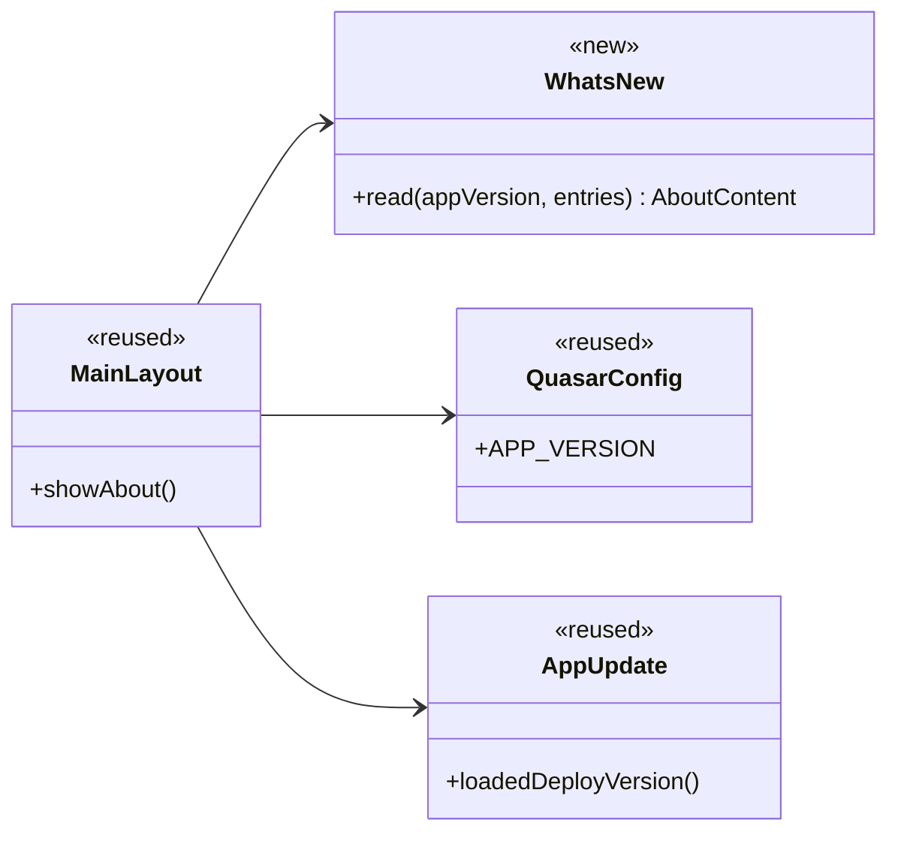

# App Settings (SETT) Design

**Project:** Drive Grader
**Team:** Team 12
**Area:** `SETT`

> **Realizes:** `UC-SETT-view-whats-new`, `FR-SETT-show-version`
> **Depends on:** no `BR-*`. [Architecture-of-record](architectural-design.md) section 8.2.1 (a missing local value stays on the device), 8.2.4 (Vue 3 and Quasar), 8.2.6 (`APP_VERSION` is already a build value), 8.2.10 (Node's built-in test). Glossary: App Version, What's New.
> **See:** [UC-SETT-view-whats-new](../requirements/use-cases.md), [FR-SETT-show-version](../requirements/software-requirements-specification.md), [architectural-design.md](architectural-design.md)
> **Designed against:** `eecd2d2` on `docs/align-local-knowledge` (2026-10-28). The About dialog matches `origin/stg` at `82e304b`. `origin/main` at `78f4eb3` does not contain that dialog. There is no local `main`.

---

## Overview

App settings shows a signed-in user the App Version shipped with this build and the What's New entries shipped with it. The area is `SETT` in the [use case areas](architectural-design.md#52-use-case-areas-and-components), inside the phone client on the [container diagram](architectural-design.md#51-containers). It reads no other area and calls no API. About already opens from the signed-in drawer in `frontend/src/layouts/MainLayout.vue`. This design adds the shipped summary to that dialog. The architecture sentence this adds is under [Changes to the architecture-of-record](#changes-to-the-architecture-of-record).

`UC-SETT-toggle-dark-mode` is already built and is not designed here. The About dialog continues to follow the active theme.

## Components & classes



- `frontend/src/layouts/MainLayout.vue` (reused): the About item and the dialog. `showAbout` displays `WhatsNew.read`'s text as text nodes. It does not interpolate the summary into the dialog's HTML string. The existing title, icon, and one-line description stay. The version line and the What's New entries follow that description.
- `frontend/src/utils/whatsNew.js` (new): the shipped entries, and `read(appVersion, entries)`. Each entry is `{ version, text }`. `version` is the App Version that entry describes. `text` is the summary. The dialog shows each entry's `version` and its full `text`, with no truncation. A release that changes the app edits this list in the same change as the patch bump in `frontend/package.json`. The first list is empty. No changelog text is invented here. The unit test is `frontend/src/utils/whatsNew.test.js`.
- `frontend/quasar.config.js` (reused): sets `APP_VERSION` from `frontend/package.json` at build time. About passes that value through with no `|| '0.0.0'` fallback.
- `frontend/src/utils/appUpdate.js` (reused): `loadedDeployVersion()` is the deploy build identifier shown beside the App Version when one is already loaded. What's New is not keyed to it. Check for Updates is unchanged.
- `frontend/src/pages/LoginPage.vue` (reused, unchanged): the login version line stays as it is, including its `0.0.0` fallback. That line is outside this use case.

`read` compares App Versions as numeric `major.minor.patch`, descending, so `1.0.10` sorts ahead of `1.0.9`. Entries that name the same App Version keep file order. Releases stay `x.y.z`. An entry whose `version` is not `x.y.z` is still shown, with that text as written, after the numeric versions, in file order. It is not dropped and not rewritten as `0.0.0`.

`read` trims `appVersion`. Null, undefined, blank, or whitespace-only is unavailable. The string `0.0.0`, when `package.json` actually contains it, is the shipped App Version and is shown. A known App Version appears as that `package.json` string. The dialog may keep today's `v` prefix in front of it, as in `v1.0.6`.

The dialog text is:

- Unavailable App Version: "The version is unavailable."
- The App Version is known and no entry names it, while older entries exist: "This version has no summary." Older entries still appear, newest version first.
- No entries are shipped: "There is no summary."
- The App Version is unavailable and entries are shipped: the unavailable sentence, then those entries newest version first. The dialog does not say "This version has no summary." because the version is unknown.
- The App Version is unavailable and nothing is shipped: both "The version is unavailable." and "There is no summary."

`read` does not receive the deploy build identifier. When `loadedDeployVersion()` is non-empty, `showAbout` shows that identifier beside the version line and labels it as the build. It is never substituted for the App Version. An unavailable version is not rendered as `v0.0.0`.

## Sequence

### UC-SETT-view-whats-new: viewing the version and recent changes

```mermaid
sequenceDiagram
    actor U as Signed-in user
    participant L as MainLayout
    participant W as WhatsNew
    U->>L: Selects About (step 1)
    L->>W: Read the app version and the shipped entries (step 2)
    alt The app version cannot be read (2b)
        W-->>L: The version is unavailable; shipped entries still listed
    else No entry for this app version, older entries exist (2a)
        W-->>L: App version, this version has no summary, older entries newest first
    else No entries shipped (2a)
        W-->>L: App version, and there is no summary
    else
        W-->>L: App version and the entries, newest version first
    end
    L-->>U: About shows that result (step 3)
```

Step 4 ends the use case. Nothing is stored. The deploy build identifier, when already loaded, is part of the step 3 display and is not a What's New key.

## API contract

| Endpoint or job | Caller (who may) | Request | Success | Errors, by extension |
|---|---|---|---|---|
| None | Any signed-in user, from the About item in the signed-in drawer. No API. | None | The dialog shows the local read: the App Version or the unavailable sentence, the deploy build identifier when one is already loaded, and the What's New entries newest version first | 2a and 2b are the sentences under Components & classes. They are not HTTP errors and do not use the section 8.2.1 error body |

## Key decisions

**Where What's New lives.** A module shipped in the phone client. Each entry names the App Version it describes. The first list is empty, so the first build follows extension 2a until a release adds entries. Rejected: `GET /api/whats-new`, because the use case says the text ships with the build. A server copy could describe a version this phone is not running. Rejected: writing a 1.0.6 changelog in this design. The client did not supply that text.

**Which version the entries use.** The App Version from `frontend/package.json`, exposed as `APP_VERSION`. Order is numeric `major.minor.patch`, descending. The same version keeps file order. Rejected: keying the summary to the deploy build identifier in `version.txt`. That identifier is what Check for Updates compares, and the glossary keeps it separate from the App Version. Rejected: lexicographic sort, which would place `1.0.9` ahead of `1.0.10`.

**What About does when the version is missing.** A blank or missing `APP_VERSION` is unavailable. The dialog does not invent `0.0.0`. A literal `0.0.0` in `package.json` is shown. Rejected: changing the login screen. The use case says that line stays as it is.

**How much history appears.** Every shipped entry, newest App Version first. Rejected: only the current version's blurb. Extension 2a keeps older entries on screen.

**How it is tested.** Node's built-in test in `frontend/src/utils/whatsNew.test.js`, the runner section 8.2.10 names, against `frontend/src/utils/whatsNew.js`. `showAbout` displays that function's text for the version and the summary. Rejected: adding a frontend test runner. This repository has none, and these rules are pure. The wiring risk is under Open questions & risks.

## Data model

No change. What's New is content shipped in the phone client. The use case stores nothing.

## Reuse & cross-cutting

- Section 8.2.1: a missing version is a local failure on the phone. It is not a Fastify error.
- Section 8.2.4: the dialog stays a Quasar dialog in the existing Vue layout.
- Section 8.2.6: no new environment variable. `APP_VERSION` is already set from `package.json`.
- Section 8.2.10: Node's built-in test. No MySQL and no transaction, because there is no row.
- `UC-SETT-toggle-dark-mode`: the About dialog keeps following the theme. This design does not change that control.
- Check for Updates and `frontend/src/pages/LoginPage.vue` stay as they are.

## Tests

| Use case, flow | Level | Asserts |
|---|---|---|
| `UC-SETT-view-whats-new` main | unit | A known App Version and entries for that version and an older one produce the App Version and the entries newest version first. `1.0.10` precedes `1.0.9`. Two entries for one version keep file order |
| `UC-SETT-view-whats-new` 2a, older entries exist | unit | The App Version is shown, the result states "This version has no summary.", and older entries still appear newest version first |
| `UC-SETT-view-whats-new` 2a, nothing shipped | unit | The App Version is shown and the result states "There is no summary." |
| `UC-SETT-view-whats-new` 2b | unit | A null, undefined, blank, or whitespace-only App Version produces "The version is unavailable.", the result does not contain `0.0.0`, and shipped entries still appear. The string `0.0.0` as input is shown as the App Version |
| `UC-SETT-view-whats-new` entry shape | unit | An entry is `{ version, text }`. Its `version` and full `text` both appear. An entry whose `version` is not `x.y.z` is shown as written, after the numeric versions, in file order, and is not rewritten as `0.0.0` |

## Changes to the architecture-of-record

The `SETT` row in [section 5.2](architectural-design.md#52-use-case-areas-and-components) now includes the App Version and What's New summary shown on About. Depends on stays Phone client. Status stays provisional. `KD-deployment-shape` is not edited.

## Open questions & risks

- **The two package versions.** `frontend/package.json` is `1.0.6`. `api/package.json` is `1.0.0`, and the API does not report a version. `KD-deployment-shape` says a release is not finished until both containers report the same version. This use case shows only the phone client's App Version. Neither package version is changed here.
- **The dialog can ignore the reader.** A unit test of `read` passes even if `showAbout` keeps rendering `buildLabel` and its `0.0.0` fallback. `/implement` wires `showAbout` to `read` and passes `APP_VERSION` through with no fallback. There is no component test.
- **The first build has no summary.** The shipped list starts empty, so About follows extension 2a until a release adds entries. That matches the app today. It does not invent the client's changelog.
